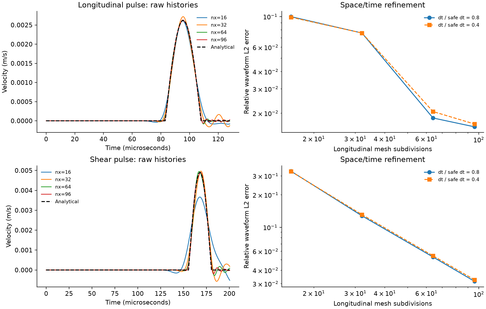

# 高阶显式动力学开发与验证报告

开发分支：`feat/explicit-dynamic-parity`。基线：`8b629b29`。

## 交付结论

本分支新增真实节点集中力、独立节点/空间测点历史、Tet4/Tet10零厚度seam、正质量高阶显式单元、稳定时间步估计和原始时程对标工具，并修复显式积分在MPI拥有节点与幽灵节点长度不一致时的加速度更新问题。通用能力位于平台，示例保留可读的物理建模过程。

**这不是“叶片已对标成功”的交付。** C3D10M专有修正插值、辅助模式和沙漏控制尚未实现；本次提供明确命名的`tet10_hrz`与文献型`tet15_nodal`两条独立路线。输入目录未提供原始叶片INP与Abaqus历史CSV，不能恢复并验证相同网格、同一节点载荷和同一测点。

| 任务 | 本次交付 | 尚未闭合的部分 |
|---|---|---|
| T1 INP审计 | 保留平铺INP节点身份、单元连接、集合、表面、载荷/幅值/输出原始卡片及来源；明确报告不支持公式 | 不是自动执行全部INP；Part/Instance/Include须经既有迁移流程 |
| T2 节点力 | 标签/节点集/唯一坐标选择、标量与表格幅值、MPI唯一装配、合力、外力功、重启 | 当前为小应变显式、全局方向、齐次固定支座；不包含接触或黏聚能量 |
| T3 历史 | U/V/A三分量、模值、保留采样最大值、FE插值权重、独立频率、CSV/JSON、MPI/重启 | 空间点位于重合裂纹面时应使用节点身份选侧；不推断采样间极值 |
| T4 seam | Tet4/Tet10角点及中边点零厚度分裂、显式共享裂纹前缘、法向/来源映射 | 拓扑工具；原始Abaqus叶片裂纹仍须外部资料核对 |
| T5 高阶显式单元 | Tet10 HRZ及文献型富集Tet15正质量单元，独立补丁/惯量/频率/波传播证据 | **非C3D10M等价公式**；Tet15增加自由度，不能宣称保持10节点公式 |
| T6 显式过程 | 中央差分、保守稳定步长、固定步长、能量/外力功、检查点；MPI修复 | 自动步长限定线弹性算子；未增加质量缩放；移动支座功未实现 |
| T7 对标报告 | 原始速度、累计最大值、首波、峰值、RMS、L2、相关系数、分量频谱、比值及来源元数据 | 尚无Abaqus实测输入；健康/裂纹对比必须明确两条曲线身份 |

## 关键设计与实际结果

### 1. 正质量并不等于相同动力学

普通P2四面体行和集中会产生负角点质量，不能靠容差放行。HRZ方案保持总质量和质心，但本次独立计算发现，其单元刚体转动惯量相对一致质量的偏差约为**103.70%**；单元高频谱也有明显变化。因此保留该结果，不以“质量为正”代替波传播验证。

富集Tet15采用`P2 + 4个三次面泡函数 + 1个四次体泡函数`。15个节点分别为4角点、6中边点、4面心、1体心。参考体积1/6下，节点权重为`17/5040、2/315、9/560、16/315`，全部为正。

规则及仿射畸变单元的独立积分检查得到：

- 恰有6个刚体零模态，无额外零能模态；刚体残量小于`5×10⁻¹⁶`。
- 拉伸、剪切、体积常应变能量误差小于`1.4×10⁻¹⁴`。
- 刚体转动惯量相对误差小于`2.4×10⁻¹⁴`。
- 未采用减缩积分或沙漏稳定，人工能量为0；这不是对Abaqus沙漏机制的复现。
- 集中质量与一致质量的单单元高阶频率仍有显著差异，完整频谱已保留，不能据此宣称全部频率一致。

来源：Geevers、Mulder、van der Vegt，SIAM J. Scientific Computing（2018），Table 1，[DOI](https://doi.org/10.1137/18M1175549)。

### 2. 波传播与能量

先完成解析驻波的三档网格、两档时间步，再完成25 μs半正弦纵波和剪切波。均采用`E=210 GPa、ν=0.3、ρ=7800 kg/m³`，对应解析纵波速度`6020.183 m/s`、剪切波速度`3217.923 m/s`。

半正弦基准为约束横向分量的三维棱柱平面波，端面均布牵引，解析速度幅值为`traction/(ρc)`。它验证单元传播能力，**不是叶片节点集中力模型**。节点力另有独立合力、功和动量测试。

驻波中，最细Tet15网格、较小时间步的波形相对L2误差为`1.762×10⁻⁶`，相对能量漂移约`2.299×10⁻⁶`。这些数字仅对应该已给定的线弹性驻波。

半正弦原始数据见[收敛记录](evidence/half_sine_waves/convergence.json)。首波按解析幅值的1%固定绝对阈值判定，不对曲线平移、平滑或缩放。粗网格存在明显提前到达及色散；峰值误差存在时空误差抵消，不能要求读者只看最有利的一点。下表与图由完整记录生成。

| 波型 | 网格nx | dt/safe dt | 首波误差 | 峰值误差 | 波形L2误差 |
|---|---:|---:|---:|---:|---:|
| 纵波 | 16 | 0.8 | 10.420% | 0.874% | 9.990% |
| 纵波 | 16 | 0.4 | 10.966% | 0.410% | 9.900% |
| 纵波 | 32 | 0.8 | 6.050% | 3.793% | 7.605% |
| 纵波 | 32 | 0.4 | 5.336% | 3.766% | 7.606% |
| 纵波 | 64 | 0.8 | 0.959% | 0.103% | 1.847% |
| 纵波 | 64 | 0.4 | 1.095% | 0.160% | 2.056% |
| 纵波 | 96 | 0.8 | 0.653% | 0.343% | 1.594% |
| 纵波 | 96 | 0.4 | 0.685% | 0.422% | 1.671% |
| 剪切波 | 16 | 0.8 | 13.681% | 25.312% | 33.201% |
| 剪切波 | 16 | 0.4 | 13.778% | 25.213% | 33.001% |
| 剪切波 | 32 | 0.8 | 6.763% | 1.361% | 12.781% |
| 剪切波 | 32 | 0.4 | 6.657% | 1.299% | 13.113% |
| 剪切波 | 64 | 0.8 | 1.244% | 0.843% | 5.305% |
| 剪切波 | 64 | 0.4 | 1.261% | 0.960% | 5.441% |
| 剪切波 | 96 | 0.8 | 0.767% | 0.013% | 3.154% |
| 剪切波 | 96 | 0.4 | 0.865% | 0.050% | 3.257% |



四档网格、两档时间步共16组。在最细网格较小时间步下，纵波/剪切波首波误差分别为0.685%/0.865%，峰值误差为0.422%/0.050%，波形L2误差为1.671%/3.257%。波形误差随空间细化下降；峰值误差仍有非单调抵消，全部数据均列出。

### 3. MPI与重启

同一三维自由块体，P2/HRZ、表格节点力、非节点空间测点，比较串行与2进程。连续计算与第4步检查点续算逐项核对U/V/A、全部历史和能量通道。

[原始比较记录](evidence/mpi_comparison.json)给出最大绝对差约`2.78×10⁻¹⁷`；两种进程数下连续/重启记录一致。该测试不代表任意进程数、任意非线性材料均已验证。

Tet15另有双进程正质量、节点力、线动量及角动量检查。全场Tet15 XDMF目前验证为串行；MPI历史和检查点是独立支持项。

### 4. 输出与使用方式

完整建模示例：[`case.py`](../../examples/explicit_nodal_pulse/case.py)。

- 默认Tet15钢块，真实角点−1230 N节点力，25 μs半正弦；不含叶片硬编码。
- 输出XDMF/HDF5、测点CSV/JSON和运行摘要。
- Tet15 HDF5保留所有原生自由度值及SourceCellDofs；显示网格为每个源单元24个线性子四面体，已明确标记，不改变求解公式。
- API、支持范围与数值原理见[设计说明](../../docs/design/explicit_dynamic_parity.md)。

## 验收状态

| Gate | 状态 |
|---|---|
| A 基础组件 | 当前支持范围的节点力、功、历史、seam身份、MPI/重启测试通过；不是所有材料/约束组合的承诺 |
| B 单元级 | 独立Tet15补丁、正质量、惯量与零模测试通过；频谱差异如实保留。原任务C3D10M等价性未通过 |
| C 波传播 | 已完成纵波/剪切波多网格、多时间步；细网格首波达到2%建议门槛。峰值并非全档单调，仍需结合原始收敛图判断，不能笼统标记所有条件通过 |
| D Abaqus小模型 | 缺少实际Abaqus同模型输入/输出，尚未开展 |
| E 叶片 | 未开展；必须取得原始健康/裂纹INP、测点、时程、时间步及能量记录 |

## 复现与测试记录

运行环境见[environment.json](evidence/environment.json)。在已安装FEniCSx的环境中，以仓库根目录为工作目录：

```sh
export PYTHONPATH=src
python -m pytest -q tests/test_dynamic_parity.py
python validation/dynamic_parity/element_checks.py
python validation/dynamic_parity/enriched_checks.py
python validation/dynamic_parity/longitudinal_wave.py --element tet15_nodal
python validation/dynamic_parity/pulse_wave.py --meshes 16 32 64 96
python validation/dynamic_parity/plot_wave_evidence.py
python validation/dynamic_parity/mpi_restart.py /tmp/afm-serial
mpiexec -n 2 python validation/dynamic_parity/mpi_restart.py /tmp/afm-mpi2
python validation/dynamic_parity/compare_mpi_evidence.py /tmp/afm-serial /tmp/afm-mpi2
python examples/explicit_nodal_pulse/case.py --output /tmp/afm-pulse --element tet15_nodal
```

本机MPI默认网络发现存在退出挂起，确认后仅对测试进程设置`FI_PROVIDER=sockets FI_SOCKETS_IFACE=en0`；没有修改用户全局网络或MPI配置。其他机器应使用自己的有效网络接口。

最终新增能力测试21项通过；相关动力学/输入/历史回归173项通过；公共接口、架构、单元与项目发布约定62项通过；输出相关回归108项通过；双进程专项4项通过（每个进程各报告4项）。标准项目`agentfem run`也已实际完成并发布结果清单。测试日志见[test_logs](evidence/test_logs)。不同回归批次存在重叠，不将通过数相加宣传为独立测试数。

## 后续必须完成的工作

1. 取得原始INP和Abaqus原始CSV/能量/时间步，落实D/E；不得用重建STEP网格冒充原始网格。
2. C3D10M兼容公式须独立立项验证，或与对方明确接受独立高阶单元进行方法比较；Tet15不是无差别替换。
3. 根据实际曲面网格、约束、材料分区评估是否需要曲边/变密度扩展；当前版本明确限定仿射单元和常密度。
4. 当前分支供审查，未自动合并、发布或更新客户环境。

## 通用单元开发补充：复合四面体公式（2026-11-16）

本轮仅开发通用软件与验证单元公式，未运行叶片或其他应用仿真。

新增 `elements.composite_tet10(coordinates)`：12 子四面体分片线性插值、
父单元线性梯度投影、一致/正对角质量、小应变刚度、平均体积应变分支及
显式临界步长。现阶段为局部算子 API，尚未接入完整 Step、分布式装配和输出。

关键发现：普通投影具有 6 个刚体零模态；平均体积应变后，未稳定化分支
出现额外 3 个零能模态。新增偏应变投影残差能量稳定化，保留常应变精度，
消除该问题；独立的子四面体直接能量积分验证了各向同性情况下的能量恒等式。
没有调参来拟合 Abaqus，也没有声称复现 C3D10M 内部变量及沙漏控制。

新增公式测试 8 项通过；已有动态回归 21 项通过；单元契约、单元惯性、
架构契约及集中质量契约共 45 项通过。检查覆盖 24 种顶点重排、刚体运动、
常应变、质量与惯性、刚度秩、能量导数、长度/密度/刚度尺度及不支持输入拒绝。

推导、使用范围与公开来源：`docs/theory/composite_tetrahedron.md`。
C3D10M 导入仍维持“拓扑可读、专用公式未实现”的状态，不改变原有含义。

## 整网格、Step与结果交付补充（2026-11-16）

本轮继续在 `feat/explicit-dynamic-parity` 开发，完成上一节局部内核至整网格工作流的接入；未运行叶片仿真，不依赖外部 INP/CSV。

### 已完成的通用能力

- 公开入口：`fields.displacement(..., element_policy=elements.composite_tet10_policy(...))`，通过标准 `model.step` 与 `step.solve_result` 完成显式动力学；提供可直接运行、发布的标准项目 `examples/composite_tet_dynamics`。
- 分布式单元装配、正对角质量、自动稳定时间步、固定/给定位移约束、同分区检查点恢复；复用通用外力功与能量记录，不另造一套求解生命周期。
- 支持材料分区和常系数各向异性线弹性；常量体力、面力、参考压力与节点力采用复合插值的一致离散。错误的求解选项及不支持的载荷明确拒绝，不能静默退回普通 P2 公式。
- 探针、历史和科学输出均使用实际复合插值。输出 U/V/A、应力、应变、等效应力及应变能密度；XDMF/HDF5 保留原生自由度、源单元映射和分片显示网格，可由现有统一读取器读取。
- 修正刚体运动附近能量的浮点消去问题；稳定化能量单独记录。共享显式组件提取后，已有 Hex8 路径继续通过回归。

### 自动化验证

- 串行相关回归：277 项通过、14 项 MPI 专用测试在串行环境跳过。包含公式、动力学、重启、架构、质量、结果输出等；原始记录见 `composite_step/serial_regression.txt`。
- 最后输出集成回归：66 项通过，覆盖新增统一读取、标准项目运行与发布，见 `composite_step/output_integration.txt`。
- 双进程复合单元专项：每个进程 8 项通过，覆盖并行装配、一致载荷、刚体加速度、材料分区和整体仿射补丁，见 `composite_step/mpi2_regression.txt`。
- 公共结果双进程回归：每个进程 14 项通过，见 `composite_step/mpi2_results.txt`。
- 八进程、六单元空分区专项：每个进程 1 项通过，见 `composite_step/mpi8_empty_partition.txt`。
- 各批次测试存在重叠，不将数字相加作为独立测试总数。双进程 pytest 临时目录清理出现目录非空警告，不影响求解或测试结果。

### 公式与交付边界

本实现是独立复合 Tet10：12 个子四面体、约束中心、投影梯度和偏应变残差稳定化。它不是 Abaqus C3D10M 的直接复刻；后者的额外独立变量及专用控制未被等价实现，导入时仍不将二者互换。

当前完整链路支持仿射四面体、小应变线弹性显式动力学；曲边、有限应变、塑性、接触及跨分区重启不在本轮支持范围。MPI 科学输出采用汇集到主进程后写入，已验证一致性，但主进程内存随输出规模增长，不宣称可扩展的并行 HDF5。

推导与主来源见 `docs/theory/composite_tetrahedron.md`；公共使用方式见 `examples/composite_tet_dynamics/README.md`。
